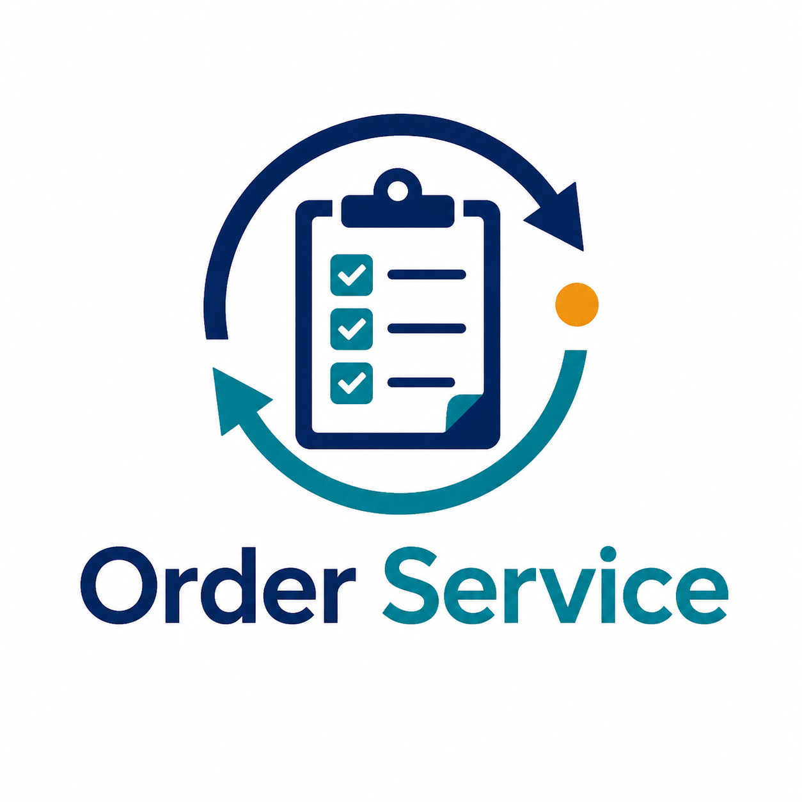

# Order Service

Sistema genérico de gestão de ordens de serviço para demonstração, desenvolvimento e adaptação a diferentes empresas. O projeto tem painel administrativo, aplicativo do funcionário, atualização em tempo real, relatórios e armazenamento local com dados fictícios.

> Este repositório é uma base neutra. Não contém identidade, dados ou regras específicas de uma empresa.

## Sumário

- [Visão geral](#visão-geral)
- [Funcionalidades](#funcionalidades)
- [Permissões](#permissões)
- [Tecnologias](#tecnologias)
- [Pré-requisitos](#pré-requisitos)
- [Instalação local](#instalação-local)
- [Acesso de demonstração](#acesso-de-demonstração)
- [Estrutura do projeto](#estrutura-do-projeto)
- [Configuração](#configuração)
- [Fluxo de uma ordem de serviço](#fluxo-de-uma-ordem-de-serviço)
- [API principal](#api-principal)
- [Testes e validações](#testes-e-validações)
- [Build para desktop e Android](#build-para-desktop-e-android)
- [Deploy](#deploy)
- [Migração relacional e mídias](#migração-relacional-e-mídias)
- [Como contribuir](#como-contribuir)
- [Boas práticas de segurança](#boas-práticas-de-segurança)
- [Licença](#licença)

## Visão geral

O Order Service separa a operação em duas interfaces:

- **Painel administrativo:** clientes, funcionários, equipes, materiais, ordens, financeiro e relatórios.
- **Aplicativo do funcionário:** serviços atribuídos, abertura de novas OS, início, atualizações, finalização, localização pontual, fotos e assinatura.

O modo local usa `backend/data/db.json`, permitindo apresentar o sistema sem banco externo. A aplicação também possui estrutura preparada para PostgreSQL e Object Storage compatível com S3, mas essas integrações ficam desativadas por padrão na demonstração.

## Funcionalidades

- Cadastro, edição, ativação e exclusão lógica de funcionários.
- Cadastro de clientes e materiais com busca por código.
- Equipes com líder, membros e distribuição automática de serviços.
- Criação de ordens de serviço com cliente, local, endereço, data, horário, observações e materiais.
- Funcionário pode abrir uma OS diretamente pelo próprio aplicativo.
- OS aberta por funcionário é atribuída exclusivamente ao funcionário autenticado.
- Atualizações em tempo real via Socket.IO.
- Início e finalização com validação de permissão.
- Localização pontual no início e na finalização, sem rastreamento contínuo.
- Fotos de antes e depois e assinatura digital do cliente.
- Precificação, recebimento, reabertura de pagamento e envio ao cliente.
- Relatórios PDF com anexos externos.
- Recuperação de serviços cancelados.
- Exclusão definitiva protegida por regras do fluxo.
- Cenário fictício pronto para apresentação.
- Aplicativo desktop com Electron e base Android com Capacitor.

## Permissões

As permissões são aplicadas no backend. A interface apenas apresenta as ações permitidas; esconder um botão nunca é considerado uma proteção suficiente.

| Ação | Administrador | Funcionário |
| --- | :---: | :---: |
| Acessar painel administrativo | Sim | Não |
| Gerenciar clientes, materiais, equipes e funcionários | Sim | Não |
| Criar OS para qualquer cliente/equipe | Sim | Não |
| Abrir uma OS pelo aplicativo | Não se aplica | Sim |
| Definir preço | Sim | Não |
| Receber ou reabrir pagamento | Sim | Não |
| Enviar relatório ao cliente | Sim | Não |
| Visualizar serviços atribuídos | Sim | Sim |
| Iniciar serviço | Não | Somente líder da equipe, quando aplicável |
| Adicionar atualização ao serviço | Não | Somente funcionário atribuído |
| Finalizar serviço | Não | Funcionário atribuído ou membro da equipe |
| Registrar fotos, localização e assinatura | Não | Funcionário autorizado no serviço |

### Regra para abertura de OS pelo funcionário

Quando um funcionário usa `POST /api/services`, o servidor ignora tentativas de enviar `clientId`, `teamId`, `employeeIds` ou preço em nome dele. A ordem é criada com:

- `employeeIds` contendo somente o ID do usuário autenticado;
- preço inicial igual a zero e status pendente;
- equipe e cliente administrativo não definidos;
- gerenciamento posterior reservado ao administrador.

Essa regra evita que o cliente consiga atribuir uma OS a outra pessoa ou alterar dados financeiros pela requisição.

## Tecnologias

- **Frontend:** HTML, CSS, JavaScript modular e Vite.
- **Backend:** Node.js, Express, Socket.IO e PDFKit.
- **Persistência local:** JSON em `backend/data/db.json`.
- **Persistência preparada:** PostgreSQL com `pg`.
- **Mídias preparadas:** Object Storage compatível com S3.
- **Desktop:** Electron.
- **Mobile:** Capacitor e Android.
- **Testes:** Node.js Test Runner.

## Pré-requisitos

- Node.js 20 ou superior.
- npm 10 ou superior.
- Git.
- Para Android: Android Studio, SDK e Java configurados.
- Para desktop: dependências nativas compatíveis com Electron.

Confira as versões instaladas:

~~~bash
node --version
npm --version
git --version
~~~

## Instalação local

Clone o projeto e instale as dependências na raiz:

~~~bash
git clone <URL_DO_REPOSITORIO>
cd servicos
npm install
~~~

Crie os arquivos locais de configuração:

~~~powershell
Copy-Item backend/.env.example backend/.env
Copy-Item frontend/.env.example frontend/.env
~~~

Para a apresentação local, `backend/.env` deve conter pelo menos:

~~~dotenv
NODE_ENV=development
APP_NAME=Order Service
HOST=127.0.0.1
PORT=3000
DB_CLIENT=json
DEMO_MODE=true
ALLOW_LOCAL_ORIGINS=true
~~~

Suba backend e frontend em terminais separados:

~~~bash
npm run dev:backend
npm run dev:frontend
~~~

Acesse:

- Página inicial: <http://localhost:5173>
- Painel administrativo: <http://localhost:5173/admin/>
- Aplicativo do funcionário: <http://localhost:5173/funcionario/>
- Saúde da API: <http://localhost:3000/api/health>

Se a porta 3000 estiver ocupada no Windows:

~~~powershell
Get-NetTCPConnection -LocalPort 3000 -State Listen |
  Select-Object LocalPort, OwningProcess
~~~

Depois, identifique o processo antes de encerrá-lo:

~~~powershell
Get-Process -Id <PID>
~~~

Alternativamente, use outra porta no `backend/.env` e ajuste `VITE_API_URL` no `frontend/.env`.

## Acesso de demonstração

O botão **Entrar na apresentação sem senha** funciona somente em ambiente local, com `DEMO_MODE=true` e origem de loopback.

| Perfil | Usuário | Senha/PIN |
| --- | --- | --- |
| Administrador | `admin@exemplo.local` | `admin123` |
| Ana Martins | acesso do funcionário | `1234` |
| Rafael Costa | acesso do funcionário | `5678` |
| Luiza Almeida | acesso do funcionário | `2468` |

Recarregue os dados fictícios quando precisar restaurar o cenário inicial:

~~~bash
node backend/scripts/load-demo-data.js
~~~

Esse script é exclusivo para apresentação e desenvolvimento. Não execute em uma instalação com dados reais.

## Estrutura do projeto

~~~text
.
├── apps/desktop/                 Aplicação desktop Electron
├── android/                      Projeto Android gerado pelo Capacitor
├── backend/
│   ├── data/                     Banco JSON local
│   ├── scripts/                  Carga demo, migrações e utilitários
│   ├── server/                   API, Socket.IO, store e relatórios
│   ├── sql/                      Scripts SQL
│   └── tests/                    Testes automatizados
├── deploy/                       Exemplos de configuração de servidor
├── docs/                         Runbooks e documentação técnica
├── frontend/
│   ├── admin/                    Página do administrador
│   ├── funcionario/              Página do funcionário
│   └── public/assets/             CSS, JavaScript, ícones e logo
├── capacitor.config.json         Configuração mobile
├── package.json                  Scripts e workspaces
└── README.md                    Documentação principal
~~~

## Configuração

As variáveis principais estão documentadas em `backend/.env.example` e `frontend/.env.example`.

### Backend local

| Variável | Exemplo | Finalidade |
| --- | --- | --- |
| `NODE_ENV` | `development` | Ambiente de execução |
| `HOST` | `127.0.0.1` | Interface de rede |
| `PORT` | `3000` | Porta da API |
| `DB_CLIENT` | `json` | `json` para demo ou `postgres` para banco externo |
| `DEMO_MODE` | `true` | Habilita login local sem senha |
| `DATA_DIR` | `./data` | Pasta dos dados locais |
| `DATABASE_URL` | URL PostgreSQL | Conexão externa quando necessário |
| `OBJECT_STORAGE_ENABLED` | `false` | Habilita mídias em S3 compatível |

Nunca versione `.env`, tokens, senhas, dumps, backups ou dados de clientes.

### Frontend

Configure `VITE_API_URL` para apontar para a API:

~~~dotenv
VITE_API_URL=http://localhost:3000
~~~

## Fluxo de uma ordem de serviço

~~~text
Agendada
   ├── funcionário abre/inicia
   │      └── Em andamento
   │             └── Finalizada
   │                    └── Aguardando preço
   │                           └── Precificada
   │                                  └── Recebida
   └── Cancelada ──> recuperada ou excluída definitivamente
~~~

O administrador controla preço, pagamento, envio ao cliente e ações administrativas. O funcionário registra a execução operacional e só pode agir sobre os serviços autorizados para ele.

## API principal

### Autenticação

~~~text
POST /api/auth/admin
POST /api/auth/employee
POST /api/auth/demo
POST /api/auth/logout
GET  /api/me
~~~

### Dados administrativos

~~~text
GET/POST/PATCH/DELETE /api/clients
GET/POST/PATCH       /api/materials
GET/POST/PATCH/DELETE /api/teams
GET/POST/PATCH/DELETE /api/employees
GET                  /api/dashboard
GET                  /api/my-teams
~~~

### Ordens de serviço

~~~text
GET  /api/services
POST /api/services
PATCH /api/services/:id
POST /api/services/:id/start
POST /api/services/:id/finish
POST /api/services/:id/updates
POST /api/services/:id/cancel
DELETE /api/services/:id
PATCH /api/services/:id/price
POST /api/services/:id/receive-payment
POST /api/services/:id/reopen-payment
POST /api/services/:id/sent-to-client
~~~

### Relatórios

~~~text
POST /api/reports/client-pdf
POST /api/reports/service-pdf
~~~

As rotas protegidas recebem `Authorization: Bearer <token>`. A validação de papel e de vínculo com o serviço ocorre no backend.

## Testes e validações

Execute a checagem completa:

~~~bash
npm run check
npm run build:frontend
npm --prefix backend run migration:check
npm --prefix backend test
~~~

Os testes cobrem, entre outros pontos:

- permissões do funcionário ao abrir uma OS;
- bloqueio de preço e envio ao cliente para funcionário;
- criação de clientes, serviços e eventos;
- equipes, atribuições e concorrência;
- mídias, assinatura e Object Storage;
- relatórios e anexos PDF;
- migração aditiva e verificação de paridade.

Antes de abrir um pull request, confirme que `npm run check`, `npm run build:frontend` e `npm --prefix backend test` passam sem erros.

## Build para desktop e Android

### Desktop

~~~bash
npm run desktop:home
npm run desktop:admin
npm run desktop:funcionario
npm run desktop:build
~~~

### Android

~~~bash
npm run android:add
npm run android:sync
npm run android:build:debug
npm run android:open
~~~

O build mobile exige Android Studio, SDK e `JAVA_HOME` configurados. O build desktop cria os artefatos em `dist-desktop/`.

## Deploy

O frontend pode ser publicado em qualquer serviço estático e o backend em qualquer ambiente Node.js. A configuração precisa separar os dois serviços:

### Frontend

- Diretório: `frontend`
- Build: `npm run build`
- Saída: `dist`
- Variável: `VITE_API_URL=https://sua-api.exemplo.com`

### Backend

- Diretório: `backend`
- Instalação: `npm install`
- Inicialização: `npm start`
- Variáveis: copie `backend/.env.example` para o ambiente de hospedagem.

Em produção:

- use `NODE_ENV=production`;
- mantenha `DEMO_MODE=false`;
- configure CORS somente para origens conhecidas;
- use PostgreSQL ou outro armazenamento persistente;
- não use dados fictícios;
- habilite HTTPS;
- armazene segredos no gerenciador de variáveis do provedor.

## Migração relacional e mídias

O repositório inclui uma trilha opcional para migrar o JSONB legado para PostgreSQL relacional e mover fotos/assinaturas para Object Storage.

Por segurança, a configuração padrão permanece:

~~~dotenv
DATA_REPOSITORY=legacy
MIGRATION_ALLOW_WRITES=false
OBJECT_STORAGE_ENABLED=false
~~~

Comandos disponíveis:

~~~bash
npm --prefix backend run backup:postgres
npm --prefix backend run migration:check
npm --prefix backend run migration:dry-run
npm --prefix backend run migration:apply
npm --prefix backend run migration:verify
~~~

Leia [`docs/relational-migration-runbook.md`](docs/relational-migration-runbook.md) antes de executar qualquer migração. Não aplique migrations contra a demonstração local sem entender o impacto.

## Como contribuir

Contribuições são bem-vindas. O fluxo recomendado é:

1. Abra uma issue descrevendo o problema ou a melhoria.
2. Crie uma branch a partir da principal:

   ~~~bash
   git switch -c feat/nome-da-melhoria
   ~~~

3. Faça uma alteração pequena e focada.
4. Atualize testes e documentação quando necessário.
5. Rode as validações locais.
6. Faça um commit claro:

   ~~~bash
   git add .
   git commit -m "feat: permitir abertura de OS pelo funcionário"
   ~~~

7. Envie a branch e abra um pull request.

### Padrão de branches

Use prefixos descritivos:

~~~text
feat/       nova funcionalidade
fix/        correção de comportamento
refactor/   reorganização sem mudança funcional
docs/       documentação
test/       testes
chore/      manutenção
~~~

### Checklist do pull request

- [ ] A mudança está descrita no pull request.
- [ ] Os testes relacionados foram criados ou atualizados.
- [ ] `npm run check` passou.
- [ ] `npm run build:frontend` passou.
- [ ] `npm --prefix backend test` passou.
- [ ] A documentação foi atualizada.
- [ ] Nenhum `.env`, token, senha, dump ou dado real foi incluído.
- [ ] Nenhuma referência a uma empresa específica foi adicionada ao núcleo genérico.
- [ ] As permissões continuam validadas no backend.

Para detalhes adicionais, consulte [`CONTRIBUTING.md`](CONTRIBUTING.md).

## Boas práticas de segurança

- Nunca confie em permissões calculadas somente no frontend.
- Nunca habilite `DEMO_MODE` em produção.
- Não reutilize senha ou PIN de demonstração em ambiente real.
- Não registre tokens, senhas ou dados sensíveis nos logs.
- Valide tamanho, MIME type e origem de uploads.
- Use credenciais de Object Storage com o menor escopo possível.
- Faça backup antes de migrations.
- Preserve o repositório legado até a verificação de paridade.
- Mantenha as informações específicas de cada cliente fora deste projeto genérico.

## Licença

Este projeto ainda não possui uma licença open source definida. Antes de publicar ou aceitar contribuições externas, escolha uma licença adequada e adicione o arquivo `LICENSE` ao repositório.

## Status do projeto

O sistema está preparado para demonstração local e evolução colaborativa. A configuração padrão é segura para apresentação, com dados fictícios e persistência JSON local.
